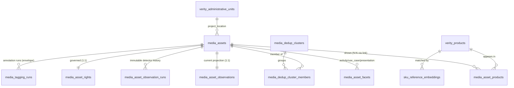

# Verity Label Schema v1 — Faceted metadata & annotation model

> **Reconciliation note (2026-09-11):** This is a schema design/history
> document, not the production runtime contract. Current production uses native
> PostgreSQL 16 + pgvector, Cloudflare R2, Better Auth and the pinned SigLIP2
> 768-d space `verity-siglip2-b32-256-webli-v1`. The live top-level media values
> are `Ảnh thực tế`, `Ảnh Studio` and `Ảnh Thiết kế`; consult
> [current-system-state.md](current-system-state.md) for operational truth.

Status: **v0.95 — facet boundaries FROZEN (see §13); A2 migration unblocked.** The
six SDR decisions (§12) are locked, and the Query Inventory forced five taxonomy
corrections that are now applied (§13). The A2 entity backbone ships as its own PR
(entity layer only — no facets/observations/governance). Facets, observations and
governance follow in later PRs.

Roadmap:

```text
Query Inventory v1  →  5 corrections  →  Taxonomy v0.95 (FROZEN)
                    →  A2 backbone migration (this PR)  →  facets  →  observations  →  governance …
```

This document **extends** the conceptual schema. The deployed native schema is
maintained as ordered numeric migrations in `backend/migrations/`; the tables
below include both current and historical compatibility names. Every production table
(`media_assets`, `review_queue`, `sku_references`, `reference_embeddings`, `verity_taxonomy_options`,
`media_tagging_runs`, …) keeps its role where deployed. DDL is illustrative;
new native changes require a numbered migration and Better Auth/server-side
authorization. Security-definer/RLS references below describe the former
Supabase design.

---

## 0. Non-negotiable invariants this schema must preserve

1. **No product/SKU is ever inferred by the Vision model.** Identity comes only from
   reference-set embedding matching. A2 keeps this: the product link is written from
   the CLIP-match path (via `media_assets.sku`), never from the caption JSON.
2. **Production embedding space is locked** to the pinned local SigLIP2
   `siglip2-b32-256-webli`, 768-d, `verity-siglip2-b32-256-webli-v1`. New vector
   columns inherit the same provenance guard. Older Jina/512 wording in
   historical sections is not a current deployment instruction.
3. **Taxonomy is stable-value / editable-label.** Stored rows keep an immutable
   `value` (snake_case, language-neutral from v0.95); admins edit the Vietnamese
   `label`, order, and `is_active`.
4. **Mutations are server-mediated** through native Next.js/Python/MCP gateway
   transactions gated by Better Auth roles. Historical security-definer/RLS
   examples are retained only to explain the former Supabase design.
5. **Duplicates are never auto-deleted.** Clusters keep every member and pick a
   canonical; deletion is a human action.
6. **Legal basis is current:** Luật BVDLCN **91/2025/QH15** (in force 2026-01-01) and
   **NĐ 356/2025/NĐ-CP**, not the superseded NĐ 13/2023.

---

## 1. The five data primitives (the classification rule)

Each datum is one of five primitives; the primitive dictates how it is stored.

| Primitive | Meaning | Examples | Storage |
|---|---|---|---|
| **Facet** (controlled vocabulary) | closed, finite, filterable | content_form, space_type, property_type, activity, use_case, presentation | stable `value` in `verity_taxonomy_options` |
| **Entity relation** | asset ↔ a real catalog thing | "shows Acme D200i" | N:N (`media_asset_products` → `verity_products`) |
| **Observation / measurement** | a fact a detector produced | face_count=2, blur=0.14 | typed rows + annotation envelope |
| **Semantic representation** | fuzzy, contextual meaning | caption, open tags | text + vector embedding (never a hard filter) |
| **Governance state** | policy / rights / lifecycle | consent_status, usage_scope | structured records + evidence, human/CRM sourced |

Not labels: `face_count`, `width`, `phash`, `aesthetic_score` (observations);
`public_marketing_approved` (governance); `blog_hero` suitability (derived — §8).

---

## 2. Retrieval architecture — why the layers exist

Not "AI attaches labels." A retrieval system with three parallel resolvers feeding
one candidate set, then ranking and policy gates.

```text
                       USER QUERY
                           │
            ┌──────────────┼──────────────┐
            ▼              ▼               ▼
      ENTITY resolver   FACET filters   SEMANTIC embedding
      (Product DB)      (taxonomy)      (caption/vector)
            │              │               │
            └──────────────┼───────────────┘
                           ▼
                     candidate set
                           ▼
                   quality ranking          (observations §5)
                           ▼
                   privacy / rights gate    (§5 policy, §7 rights)
                           ▼
                   channel policy           (derived §8)
                           ▼
                        ASSETS
```

**A2 is a knowledge-entity layer, not a facet.** An asset links to a *product*; the
product's relationships live in the Product DB:

```text
Asset ─shows→ Acme D200i ─belongs_to→ Smart Lock ─made_by→ Acme
                          ─supports→ Apple Home ─protocol→ Matter / Zigbee
```

So *"ảnh khóa hỗ trợ Apple Home"* resolves **Apple Home → eligible products →
media_asset_products → images**, with zero image relabeling. Relationships like
Matter/HomeKit/Zigbee must never become image labels — label economy at the
architecture level, and why A2 is the backbone.

### Layer map & where it lands

| Layer | Purpose | New in v1 | Reuses / extends |
|---|---|---|---|
| **L0 Asset facts** | technical ground truth | `aspect_ratio`, `orientation` (derived) | `dimensions`, `media_type`, `content_hash`, `phash` |
| **L1 Semantic retrieval** | match image ↔ content | `verity_products`, `media_asset_products`, `media_asset_facets`, columns `content_form`/`space_type`/`property_type` | `sku`, `sku_reference_embeddings`, `embedding`, `image_embedding`, `verity_taxonomy_options` |
| **L2 Observations** | safe/usable signals | `media_asset_observation_runs` + `media_asset_observations` + policy engine | `ai_flags.has_people`, `ai_confidence` |
| **L3 Governance** | rights, geography, provenance, dedup | `media_asset_rights`, `verity_administrative_units`, `media_dedup_clusters` | `permission`, IPTC fields, `origin_info`, `media_dedup_matches` |
| **Envelope** | trust & re-label control | `taxonomy_version`, per-annotation `review_state`/`evidence`/`qualifier` | `media_tagging_runs`, `ai_confidence`, `review_correction_log` |



---

## 3. L0 — Asset facts (canonical, never AI)

```sql
alter table public.media_assets
  add column if not exists width  integer,
  add column if not exists height integer,
  add column if not exists aspect_ratio numeric
    generated always as (case when height > 0 then round(width::numeric / height, 4) end) stored,
  add column if not exists orientation text
    generated always as (case
      when width is null or height is null then null
      when width > height then 'landscape'
      when width < height then 'portrait'
      else 'square' end) stored;
```

`content_hash` = exact-byte identity; `phash` = perceptual identity for dedup (§7.4).

---

## 4. L1 — Semantic retrieval

### 4.1 A2 — Product entity (the backbone; **this PR**)

**Problem with today's model.** `media_assets.sku` is a single flat string, and
`brand`/`category` are columns Vision can set — allowing *"sku = Acme D200i, brand =
Acme, category = Camera,"* and unable to express a hub **and** two sensors **and** a
lock in one photo.

**Design.** Promote the product to a first-class entity synced from the Product DB;
relate assets N:N with a role. Brand/category then **inherit from the catalog**.

```sql
create table public.verity_products (
  id             uuid primary key default gen_random_uuid(),   -- decision 1
  code           text not null unique,          -- immutable stable slug, e.g. 'acme-d200i'
  display_name   text not null,
  brand          text not null,                 -- joins verity_taxonomy_options(facet='brand')
  category       text,
  model_name     text,
  primary_sku    text,
  aliases        text[] not null default '{}',
  lifecycle      text not null default 'active'
                   check (lifecycle in ('draft','active','discontinued')),
  is_searchable  boolean not null default true,
  source_system  text not null,                 -- decision 2: 'woocommerce' | 'crm' | 'backfill' | 'auto_sku'
  external_id    text not null,
  source_payload jsonb not null default '{}'::jsonb,
  synced_at      timestamptz,
  created_at     timestamptz not null default now(),
  updated_at     timestamptz not null default now(),
  unique (source_system, external_id)
);

create table public.media_asset_products (
  id             uuid primary key default gen_random_uuid(),
  media_asset_id uuid not null references public.media_assets(id) on delete cascade,
  product_id     uuid not null references public.verity_products(id) on delete restrict,
  role           text not null default 'primary'
                   check (role in ('primary','secondary','background','packaging')),
  confidence     real check (confidence between 0 and 1),
  source         text not null
                   check (source in ('sku_embedding','human','catalog_import','mcp_agent')),
  evidence       jsonb not null default '{}'::jsonb,
  review_state   text not null default 'draft'
                   check (review_state in ('draft','confirmed','rejected')),
  model_id       text, model_version text,
  created_by     uuid references auth.users(id) on delete set null,
  created_at     timestamptz not null default now(),
  unique (media_asset_id, product_id)
);

-- Exactly one non-rejected primary per asset, so brand/category inheritance is
-- always well-defined. Multiple equal products => editor picks one anchor.
create unique index uq_media_asset_primary_product
  on public.media_asset_products (media_asset_id)
  where role = 'primary' and review_state <> 'rejected';
```

**Brand/category inheritance.** `media_assets.brand`/`category` become read-through
caches of the primary product for **one transitional release** (decision 4), then
reads move to the join. A vision-suggested brand may populate the cache only when no
product link exists yet.

**Historical reconciliation with `sku_reference_embeddings`.** Matching is unchanged; it gains a
`product_id` FK next to `sku` (dual-key). The product link is written from the
CLIP-derived `media_assets.sku`, **never from the vision caption JSON** — the boundary
is preserved because `media_assets.sku` itself is only ever set by the match path.

**Write path (historical proposal): a trigger, not an RPC rewrite.** Rather than editing the two
large security-definer RPCs (`complete_media_analysis`, `resolve_review_item`), the
product link is kept in sync by one `AFTER INSERT OR UPDATE OF sku` trigger on
`media_assets`. This is the idiomatic Verity pattern (enqueue/provenance are triggers),
is DRY (both RPCs and any future SKU write funnel through it), leaves the Python
worker untouched, and reads only `media_assets.sku` — so the hallucination boundary
moves intact. A human-confirmed primary link is never overwritten by the trigger; an
unknown SKU auto-creates a `draft` product rather than dropping the link.

#### Product DB → A2 sync (adapter-based)

`verity_products` is a read-model, idempotent upsert on `(source_system, external_id)`:
pull baseline + optional push webhook; unseen products → `lifecycle='discontinued'`
(never deleted; links are `on delete restrict`); distinct brand/category surfaced as
*candidate* taxonomy options an admin promotes (never auto-promoted); reviewer/auto
`draft` products reconciled against the next sync by `code`/alias.

### 4.2 Controlled facets (v0.95 — FROZEN; full values in §13)

Six facets. Single-value → columns; multi-value → `media_asset_facets`.

| Facet | Card. | Storage | Axis it answers |
|---|---|---|---|
| `content_form` | single | column | what the shot **structurally is** |
| `space_type` | single | column (FIX ⑤) | **where** it is installed / the zone |
| `property_type` | single | column | physical **building** type |
| `activity` | multi | `media_asset_facets` (+`qualifier`) | physical **action** happening |
| `use_case` | multi | `media_asset_facets` | buyer **intent / scenario** |
| `presentation` | multi | `media_asset_facets` | how the image is **presented** |

The five corrections the Query Inventory forced (v0.9 → v0.95):

- **`room_type` → `space_type`.** The axis is "install space/zone," not "room":
  `gate_fence`, `garden`, `balcony`, `garage`, `warehouse_floor` are not rooms.
  Stable keys become language-neutral snake_case; Vietnamese is the editable label.
- **`Toàn cảnh` removed.** It is composition, not a place (PROD-020 wrongly mapped a
  ceiling smoke alarm to it). Whole-scene framing is `content_form=room_scene`.
- **`comparison` is NOT `content_form` → new `presentation` facet.** Different axes:
  `content_form=product_lineup` + `presentation=comparison`, or
  `content_form=room_scene` + `presentation=before_after`. So `before_after` also
  moves activity → presentation. This is the one real retrieval-layer gap the
  inventory found: **no new layer, but a needed facet.**
- **`homestay` is NOT `property_type`.** Airbnb is usage context
  (`use_case=rental_management`); the building may be apartment/townhouse/villa/studio.
  If a query doesn't state the physical building, leave `property_type=unknown` — do
  not guess.
- **Unlock granularity via `qualifier`, not exploded values.** Keep
  `activity=unlocking` and attach a vocabulary-controlled `qualifier`
  (fingerprint/face/pin/app/nfc/physical_key/remote). Avoids the `verb×method`
  explosion (`voice_light_control`, `app_light_control`, …). SEO-001 still finds "vân
  tay" precisely.

```sql
alter table public.verity_taxonomy_options drop constraint verity_taxonomy_options_facet_check;
alter table public.verity_taxonomy_options add constraint verity_taxonomy_options_facet_check
  check (facet in ('category','space_type','property_type','content_form','activity','use_case',
                   'presentation','status','brand','product_category','permission','safety'));

alter table public.media_assets
  add column if not exists content_form  text,
  add column if not exists property_type text;

-- Multi-value facets: full envelope + optional vocabulary-controlled qualifier.
create table public.media_asset_facets (
  id             uuid primary key default gen_random_uuid(),
  media_asset_id uuid not null references public.media_assets(id) on delete cascade,
  facet          text not null,           -- 'activity' | 'use_case' | 'presentation'
  value          text not null,
  qualifier      text,                    -- controlled per facet/value (unlocking → fingerprint…)
  confidence     real check (confidence between 0 and 1),
  source         text not null check (source in ('vlm','human','mcp_agent')),
  review_state   text not null default 'draft' check (review_state in ('draft','confirmed','rejected')),
  model_id       text, model_version text, taxonomy_version text,
  created_at     timestamptz not null default now(),
  unique (media_asset_id, facet, value)
);
```

**FIX ⑤ — `space → space_type` transitional aliasing (no naming split-brain):**

```text
Physical DB column : space       (legacy)  ── kept during transition
API v0.95 field    : space_type            ── all new reads/writes
Taxonomy facet     : space_type
```

Stored values change from Vietnamese labels to snake_case keys, so a bounded backfill
maps `Phòng khách→living_room`, `Cửa chính→entrance`, … (map in §13) — once, in the
**facets migration (a later PR, not this A2 PR)**. Transitional release exposes
`space_type ⇄ space`; terminal release renames the column and drops the alias.

### 4.3 Semantic layer (already present)

`suggested_caption` + `keywords[]` + `description` remain semantic text fields;
legacy `image_embedding vector(512)` belongs to the former compatibility path.
The active visual space is `asset_embeddings`/`reference_embeddings` with the
768-d SigLIP2 contract. Open tags stay fuzzy; embeddings rank, never hard-filter.

---

## 5. L2 — Observations, separated from decisions (two-tier)

Detectors run at different times/versions; a single overwritable row loses audit
history. So: **immutable per-run history + a current projection.**

```sql
create table public.media_asset_observation_runs (
  id             uuid primary key default gen_random_uuid(),
  media_asset_id uuid not null references public.media_assets(id) on delete cascade,
  observer       text not null
                   check (observer in ('cv_face','cv_qr','ocr','vlm_privacy','cv_quality','vlm_aesthetic')),
  signals        jsonb not null default '{}'::jsonb,
  evidence       jsonb not null default '{}'::jsonb,
  model_id       text, model_version text,
  observed_at    timestamptz not null default now()
);
create index idx_observation_runs_asset
  on public.media_asset_observation_runs (media_asset_id, observer, observed_at desc);

create table public.media_asset_observations (
  media_asset_id uuid primary key references public.media_assets(id) on delete cascade,
  face_count integer, qr_barcode_present boolean, license_plate_present boolean,
  identity_document_present boolean, address_text_present boolean, phone_number_present boolean,
  sharpness real, blur real,
  resolution_tier text check (resolution_tier in ('low','sd','hd','fhd','uhd')),
  lighting text check (lighting in ('good','backlit','dark','mixed')),
  watermark_present boolean,
  aesthetic_score real check (aesthetic_score between 0 and 1),  -- decision 6: NULL until golden dataset
  human_override jsonb not null default '{}'::jsonb,
  source_runs    jsonb not null default '{}'::jsonb,
  updated_at     timestamptz not null default now()
);
```

Policy engine (derived, not stored):

```sql
create or replace function public.privacy_review_required(p_media_asset_id uuid)
returns boolean language sql stable as $$
  select coalesce(o.face_count,0) > 0 or coalesce(o.license_plate_present,false)
      or coalesce(o.identity_document_present,false) or coalesce(o.address_text_present,false)
  from public.media_asset_observations o where o.media_asset_id = p_media_asset_id;
$$;
```

PII signals are an asymmetric hard gate (PDPL 91/2025). Migration:
`ai_flags.has_people` → `face_count > 0`.

---

## 6. The annotation envelope (cross-cutting)

| Field | Meaning |
|---|---|
| `confidence` | 0..1, drives auto-approve vs escalate |
| `source` / `source_type` | metadata · cv · vlm · sku_embedding · human · mcp_agent · crm |
| `model_id` / `model_version` | which model produced it |
| `prompt_version` / `taxonomy_version` | re-label control |
| `review_state` | draft · confirmed · rejected |
| `qualifier` | vocabulary-controlled refinement (e.g. unlocking → fingerprint) |
| `human_override` / `supersedes` | human wins; audit chain |
| `evidence` | bounding_box / text_region — what the model looked at |

Reuse `media_tagging_runs` (per-run envelope), `ai_confidence`, `review_correction_log`;
v1 adds stored `taxonomy_version`, per-annotation `review_state`/`evidence`/`qualifier`,
and extends `media_tagging_runs.tagger` to `cv_safety`/`vlm_quality`.

---

## 7. L3 — Governance

### 7.1 Rights & consent (never AI-inferred)

```sql
create table public.media_asset_rights (
  media_asset_id      uuid primary key references public.media_assets(id) on delete cascade,
  usage_scope         text not null default 'internal_only'
                        check (usage_scope in ('internal_only','public_marketing_approved','brand_official_verbatim')),
  consent_status      text not null default 'unknown'
                        check (consent_status in ('granted','denied','not_applicable','unknown')),
  consent_evidence_id text, rights_holder text, rights_source text,
  allowed_channels    text[] not null default '{}',
  valid_from timestamptz, valid_until timestamptz, restriction_reason text,
  reviewed_by uuid references auth.users(id) on delete set null,
  reviewed_at timestamptz, updated_at timestamptz not null default now()
);
```

> No model may infer `consent_status` from pixels. CRM flag + human confirmation only.

### 7.2 Geography (reference entity, never inferred from pixels)

34 provincial units (2025 restructuring). Versioned master; three separate location
questions (created / shown / project).

```sql
create table public.verity_administrative_units (
  id uuid primary key default gen_random_uuid(),
  code text not null unique, name text not null, level text not null default 'province',
  valid_from date, valid_to date
);
alter table public.media_assets
  add column if not exists project_location_unit_id uuid references public.verity_administrative_units(id),
  add column if not exists location_shown_unit_id   uuid references public.verity_administrative_units(id),
  add column if not exists location_created_unit_id uuid references public.verity_administrative_units(id);
```

`project_location` comes from the CRM/order join and is authoritative.

### 7.3 Provenance / origin

Formalize `origin_info` jsonb: `source_type` (zalo_group | brand_official |
studio_verity | customer | stock), `source_ref`, `uploader`, `batch_context`,
`crop_configs`.

### 7.4 Dedup — clusters, not just pairs

```sql
create table public.media_dedup_clusters (
  id uuid primary key default gen_random_uuid(),
  canonical_media_asset_id uuid references public.media_assets(id) on delete set null,
  tier text not null check (tier in ('exact', 'near', 'similar')),
  status text not null default 'open' check (status in ('open', 'resolved', 'dismissed')),
  resolution text check (resolution in ('keep_one', 'keep_all', 'not_duplicate')),
  method_summary jsonb not null default '{}'::jsonb,
  member_count integer not null default 0,
  estimated_reclaim_bytes bigint not null default 0,
  resolved_by uuid, resolved_at timestamptz,
  created_at timestamptz not null default now(), updated_at timestamptz not null default now(),
  check ((status = 'open') = (resolution is null))
);
create table public.media_dedup_cluster_members (
  cluster_id uuid not null references public.media_dedup_clusters(id) on delete cascade,
  media_asset_id uuid not null references public.media_assets(id) on delete cascade,
  variant text not null check (variant in ('canonical', 'exact_bytes', 'phash_near', 'scene_similar')),
  similarity real,
  decision text not null default 'undecided' check (decision in ('keep', 'remove', 'undecided')),
  primary key (cluster_id, media_asset_id)
);
create table public.media_dedup_pair_suppressions (
  asset_min_id uuid not null, asset_max_id uuid not null,
  reason text not null default 'not_duplicate',
  cluster_id uuid references public.media_dedup_clusters(id) on delete set null,
  suppressed_by uuid, note text, created_at timestamptz not null default now(),
  primary key (asset_min_id, asset_max_id), check (asset_min_id < asset_max_id)
);
create table public.media_dedup_cluster_events (
  id uuid primary key default gen_random_uuid(),
  cluster_id uuid not null references public.media_dedup_clusters(id) on delete cascade,
  action text not null check (action in ('built', 'resolved', 'dismissed', 'undone', 'rebuilt_reopened')),
  payload jsonb not null default '{}'::jsonb, actor_id uuid,
  created_at timestamptz not null default now()
);
```

Clusters are materialized from connected components over `media_dedup_matches` plus
`media_assets.content_hash` exact-byte edges; canonical selection is usage count desc,
pixel area desc, then creation time asc. `tier` is a rebuildable workbench index
(`exact`/`near`/`similar`), not a permanent governance fact. Members are **kept**;
only an authenticated human may resolve a cluster. `not_duplicate` decisions are stored
in `media_dedup_pair_suppressions` and never mutate the evidence ledger.

---

## 8. Derived, never stored

- **`channel_suitability(asset, channel)`** — over aspect_ratio, resolution_tier,
  aesthetic_score, privacy gate, `media_asset_rights.allowed_channels`.
- **`publication_eligibility(asset)`** — approved AND privacy gate passes AND rights
  allow the channel. Distinct from `publish_status` (workflow state), which stays.

A `human_override` on suitability is the only stored piece.

---

## 9. Master field classification

| Domain | Field(s) | Class |
|---|---|---|
| Asset facts | media_type, width, height, size_bytes, content_hash, phash | canonical |
| Asset facts | aspect_ratio, orientation | derived |
| Product | verity_products.* | reference (Product DB sync) |
| Product | media_asset_products (role, confidence, evidence) | AI-generated → human-confirmed |
| Facets (single) | content_form, space_type, property_type | AI-generated, human-correctable |
| Facets (multi) | activity (+qualifier), use_case, presentation | AI-generated, per-value envelope |
| Semantic | caption, keywords, embedding, image_embedding | AI-generated (not a filter) |
| Observation | face_count, qr, blur, lighting (two-tier) | AI/CV observation |
| Observation | aesthetic_score | AI, **deferred** to golden dataset |
| Decision | privacy_review_required, channel_suitability, publication_eligibility | derived |
| Governance | usage_scope, consent_status, rights_holder, allowed_channels | canonical (human/CRM), never AI |
| Geography | project_location_unit_id / verity_administrative_units | reference |
| Dedup | phash, cluster membership, canonical | observation / structural |
| Envelope | model_version, prompt_version, taxonomy_version, review_state, human_override, evidence | system |

---

## 10. Cardinality summary

| Relationship | Cardinality |
|---|---|
| media_assets → media_asset_products → verity_products | N:N (role; **exactly one non-rejected primary**) |
| verity_products → sku_reference_embeddings | 1:N |
| media_assets → media_asset_facets | 1:N (activity, use_case, presentation) |
| media_assets → media_asset_observations | 1:1 (current projection) |
| media_assets → media_asset_observation_runs | 1:N (immutable history) |
| media_assets → media_asset_rights | 1:1 |
| media_dedup_clusters → media_dedup_cluster_members → media_assets | N:N |
| media_assets → media_tagging_runs | 1:N (append-only) |
| verity_administrative_units → media_assets (project_location) | 1:N |

---

## 11. Build order & migration strategy

1. Query Inventory ✅ (`docs/query-inventory-v1.md`).
2. Coverage Matrix ✅ (gaps found and applied).
3. **Freeze facet boundaries ✅** → Taxonomy v0.95 (§13).
4. **A2 backbone (historical proposal)** — `verity_products` + `media_asset_products` (+ primary
   index); `product_id` on `sku_reference_embeddings` (dual-key); the sku→product
   sync trigger; backfill `distinct sku` → draft products, `media_assets.sku` →
   primary links. **Entity layer only.**
5. Facets — extend the facet check; `content_form`/`property_type` columns +
   `media_asset_facets`; the `space→space_type` transitional aliasing + value
   backfill map; brand/category caches for one release.
6. Observations + policy engine — two-tier; `has_people`→`face_count`. `aesthetic_score`
   stays NULL pending the golden dataset.
7. Governance — rights, admin units (seed 34), location FKs; existing assets default
   to `usage_scope='internal_only'`, `consent_status='unknown'` (fail-closed).
8. Dedup clusters; 9. Envelope (`taxonomy_version`).
10. Golden dataset (200–500 images) → real precision/recall/nDCG; only now does
    `aesthetic_score` get a validated cutoff.
11. Freeze v1.0.

**Backward compatibility.** No column dropped in the migration that adds its
replacement. `sku`/`brand`/`category`/`space` remain readable/writable through
current native routes and gateways. The Vision boundary and embedding provenance
guard are never loosened; RLS/RPC wording in this historical document does not
describe the active native authorization surface.

---

## 12. Locked decisions (SDR v0.9)

| # | Decision | Resolution |
|---|---|---|
| 1 | Product entity key | `uuid id` + immutable unique text `code` |
| 2 | Product DB source | adapter-based; identity `(source_system, external_id)`; `source_payload jsonb` for extras |
| 3 | Multi-value facet storage | `media_asset_facets` for every AI multi-value facet — no `text[]` |
| 4 | brand/category cache | transitional 1 release, then canonical via product join |
| 5 | Observations | immutable runs + current projection; human override wins |
| 6 | Aesthetic scoring | defer the threshold until the golden dataset |

Plus: **exactly one non-rejected `primary` product per asset** (partial unique index).

---

## 13. Taxonomy v0.95 — FROZEN facet boundaries

Stable `value` keys are snake_case (language-neutral); Vietnamese labels and ordering
stay editable in Settings (invariant #3). All values must exist before golden-dataset
labeling, so labelers never invent ad-hoc values. `presentation` is **not** required
on every image — tag only on a clear signal.

**content_form** (single): `product` · `installed_product` · `room_scene` ·
`installation_process` · `human_interaction` · `app_ui` · `infographic` · `packaging`
· `product_lineup`

**space_type** (single): `living_room` · `bedroom` · `kids_room` · `kitchen` ·
`bathroom` · `entrance` · `gate_fence` · `balcony` · `garden` · `garage` · `hallway`
· `staircase` · `worship_room` · `office_area` · `warehouse_floor` · `showroom_area`
· `unknown`

**property_type** (single): `apartment` · `townhouse` · `villa` · `office` · `retail`
· `showroom` · `hotel` · `studio` · `warehouse` · `unknown`

**activity** (multi): `installation` · `unlocking` · `cleaning` · `monitoring` ·
`remote_viewing` · `two_way_talk` · `lighting` · `automation` · `curtain_control` ·
`app_control` · `voice_control` · `security_alert` · `charging` · `maintenance` ·
`cooking` · `massage` · `air_purifying`
— `qualifier` (controlled per activity; for `unlocking`): `fingerprint` · `face` ·
`pin` · `app` · `nfc` · `physical_key` · `remote`

**use_case** (multi): `security` · `baby_monitoring` · `elderly_care` · `pet_care` ·
`energy_saving` · `rental_management` · `gift` · `home_renovation`

**presentation** (multi): `comparison` · `before_after` · `detail_macro` ·
`size_reference`

**space label → key backfill map (for the facets PR):** `Phòng khách→living_room` ·
`Bếp→kitchen` · `Cửa chính→entrance` · `Phòng ngủ→bedroom` · `Sân vườn→garden` ·
`Ban công→balcony` · `Cầu thang→staircase` · `Gara→garage` · `Phòng thờ→worship_room`
· `Toàn cảnh→` (dropped; re-derive as `content_form=room_scene`).

> Note vs v0.9: the earlier claim "no query needed a fifth hard facet" is corrected —
> the Query Inventory surfaced a real need for the **`presentation`** facet (a new
> facet, not a new layer). `use_case` is likewise confirmed as its own facet.
