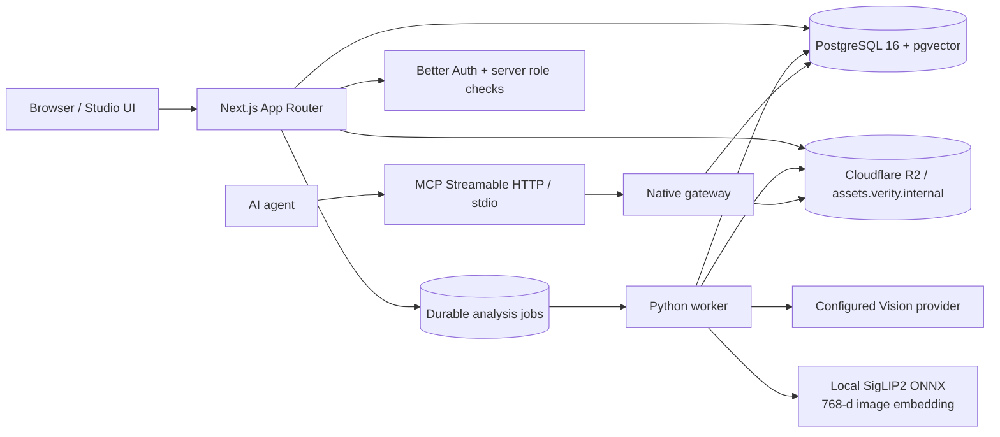
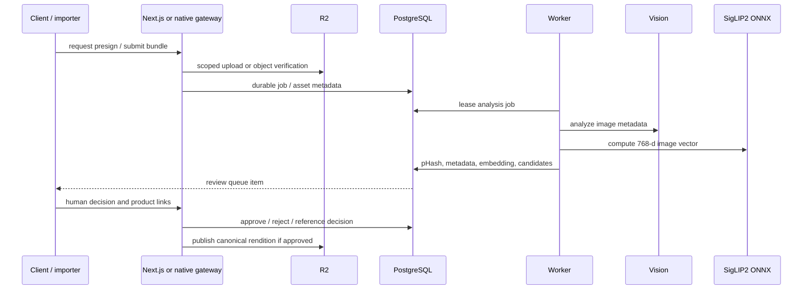

# VerityDAM — Current System Architecture

**Snapshot:** 2026-09-11

This document describes the active production architecture. The older
Supabase/PostgREST/RLS diagrams in historical ADRs and migration notes are not
the live data path.

## Runtime topology



The current production release is `/opt/verity-media/releases/<release>`. The
native migration ledger is `verity.migration_state`, applied through
`0037_product_intake_workflow.sql`.

## Service responsibilities

| Service | Responsibility | State boundary |
| --- | --- | --- |
| `verity-media-app` | Next.js pages, APIs, Better Auth, search and R2 access | Never exposes DB/storage/provider secrets to the browser |
| `verity-media-worker` | Leases jobs; pHash, Vision, embedding, dedup and publication | Writes only through native PostgreSQL/R2 contracts |
| `verity-media-mcp` | Agent-facing media/search/publish/audit tools | Native gateway and role checks |
| `verity-embedding-runtime` | Synchronous SigLIP2 ONNX runtime | Pinned artifacts mounted read-only |
| `postgres` | Native metadata, catalog, jobs, audit and vectors | PostgreSQL 16 + pgvector |

The MCP service supports visual search from an existing asset ID by reusing its
stored vector. Fresh `image_base64` search is fail-closed in the current VPS
compose because the MCP container is not yet mounted with the SigLIP2 vision
artifact; enabling that mode requires a reviewed mount and health gate.

## Data model boundaries

```text
media_assets
  ├── asset_embeddings (active SigLIP2 space)
  ├── media_asset_products ──> verity_products
  ├── review_queue / jobs / media_usages / audit
  └── sku_references ──> reference_embeddings
```

- `media_asset_products` is the canonical many-to-many product relation.
- `media_assets.sku` is a transitional single-SKU/cache field.
- `sku_references` and `reference_embeddings` are the canonical reference
  corpus used by the SKU matcher.
- A banner, multi-product image, scene without reliable identity or ambiguous
  image may have no single SKU. The system must not invent one from similarity.
- R2 owns bytes; PostgreSQL owns metadata and vector identity. Publication
  requires both the relational record and the expected R2 object to be valid.

## Ingest and publication sequence



The Google Drive curated lane performs the same contract locally before
finalization. It uses local SigLIP2 with the exact production model identity,
preprocessing, dimension and space. Folder context is policy input, not proof
that every image in a mixed folder shows that SKU.

## Embedding provenance gate

| Field | Required production value |
| --- | --- |
| Profile/provider | `local_siglip2` |
| Model | `siglip2-b32-256-webli` |
| Identity | `timm/ViT-B-32-SigLIP2-256` |
| Revision | `cd1efb47643f2794413dd79ef24397c175032780` |
| Version | `v1` |
| Space | `verity-siglip2-b32-256-webli-v1` |
| Dimension | `768` |
| Preprocess | RGB, 256×256 bicubic squash resize, mean/std 0.5/0.5 |

The source of truth for ONNX artifact identity and hashes is
`backend/benchmarks/siglip2/artifact_manifest.json`. A model, preprocessing or
dimension change requires a new versioned space and a complete re-embedding;
changing an environment variable is not a migration.

## Search architecture

The active search path uses lexical/entity evidence, semantic retrieval,
configured fusion and MMR. Production currently has search intelligence and
MMR enabled at a 100% canary. The `verity_search_config` row controls fusion and
reranking weights; it is not hardcoded into the UI.

SKU matching requires an active eligible primary reference in the current
space. Best-reference similarity is evidence, and a small runner-up margin or
missing primary anchor must remain reviewable/fail closed.

## Vision and metadata

Vision produces enrichment and evidence: title, caption, description, keywords,
visible text, category/space, safety flags and confidence. It does not establish
catalog identity by itself. The current Drive importer default is
`cx/gpt-5.6-luna`; the production provider configuration is server-side and
encrypted in native PostgreSQL.

## Taxonomy

The live top-level media taxonomy is:

- `Ảnh thực tế` — installation, showroom and real-world scenes.
- `Ảnh Studio` — controlled product/catalog photography.
- `Ảnh Thiết kế` — banners, renders and mockups.

Sub-branches are contextual metadata. Historical labels such as `Công trình`,
`Showroom` and `Banner` may remain in old migration text or rows and must be
mapped deliberately during backfill.

## Security and recovery

- Better Auth session and server-side role checks protect native APIs.
- Viewer reads are limited to approved active assets; reviewer/admin paths can
  inspect or mutate review data according to role.
- SQL is parameterized and transactions are used for identity-changing writes.
- R2 presigned URLs are scoped and server-generated.
- Soft deletion preserves relational rows and R2 bytes for recovery.
- Duplicate conflicts are held for review; they are not silently deleted.
- Secrets must remain server-side and never enter git or `NEXT_PUBLIC_*`.

## Historical boundary

Supabase/PostgREST/RLS and external Jina/OpenCLIP-512 descriptions remain in
historical documents for migration traceability. They are not valid instructions
for current production writes. Consult [current-system-state.md](current-system-state.md)
for live operational facts.
